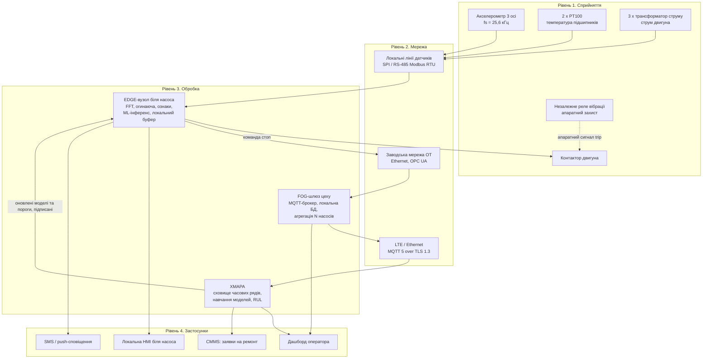
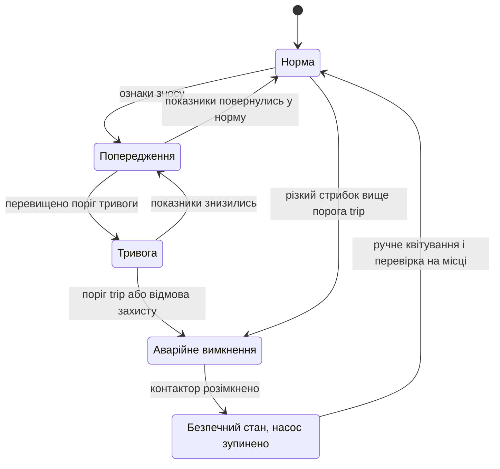
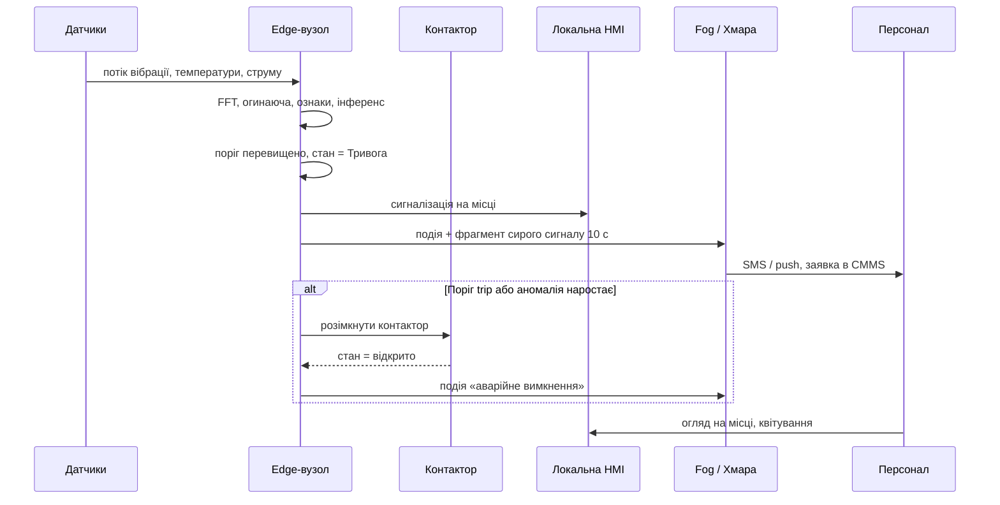

# Система раннього виявлення несправностей промислового насоса

**Практична робота 1. Варіант 4: Прогнозне обслуговування обладнання**
Дисципліна: Технології IoT та SMART-технології

> Це аналітично-проєктний документ. Програмування в роботі не передбачено.

---

## Зміст

1. [Контекст і припущення](#1-контекст-і-припущення)
2. [Фізичні величини, що свідчать про знос](#2-фізичні-величини-що-свідчать-про-знос)
3. [Архітектура системи](#3-архітектура-системи)
4. [Чому аналіз вібрації потребує edge-обробки](#4-чому-аналіз-вібрації-потребує-edge-обробки)
5. [Розподіл задач між edge, fog і хмарою](#5-розподіл-задач-між-edge-fog-і-хмарою)
6. [Реакція на аномалію та безпечний стан](#6-реакція-на-аномалію-та-безпечний-стан)
7. [Безпека](#7-безпека)
8. [Обмеження та подальша робота](#8-обмеження-та-подальша-робота)
9. [Джерела](#9-джерела)

---

## 1. Контекст і припущення

Для проєктування прийнято типовий об'єкт. Усі числа нижче залежать від цих припущень.

| Параметр | Значення |
|---|---|
| Обладнання | Відцентровий насос, асинхронний двигун 30 кВт |
| Частота обертання | 1480 об/хв, тобто f<sub>r</sub> = 1480 / 60 ≈ **24,67 Гц** |
| Режим роботи | Цілодобово, 8760 год/рік |
| Парк | 1 насос для розрахунків, система масштабується на N насосів |
| Зв'язок із хмарою | Промисловий LTE-роутер, основний канал. Проводовий Ethernet, резервний |
| Критичність | Простій насоса дорогий. Аварійна зупинка без причини теж небажана |

**Головна вимога до системи:** виявити розвиток дефекту (підшипник, незбалансованість, кавітація) за дні й тижні до відмови. При швидкому погіршенні система має самостійно, без хмари, перевести насос у безпечний стан.

---

## 2. Фізичні величини, що свідчать про знос

| Величина | Що відображає | Типові несправності | Датчик |
|---|---|---|---|
| **Вібрація** (прискорення, 3 осі) | Механічні удари, дисбаланс, зазори | Дефекти підшипників, незбалансованість, розцентровка, ослаблене кріплення, кавітація | MEMS або IEPE акселерометр на корпусі підшипника |
| **Температура** | Тертя, погіршення мастила, перегрів обмоток | Знос і нестача мастила, перевантаження | PT100 ×2 (підшипник з боку приводу і з протилежного боку) |
| **Струм двигуна** (3 фази) | Навантаження на валу, електромеханічний стан | Заклинювання, кавітація, обрив стрижнів ротора, перевантаження | Трансформатори струму ×3 |

### Чому вібрація інформативна найраніше

Дефект підшипника спершу створює дуже короткі удари, що збуджують резонанс корпусу в діапазоні **2–10 кГц**. У загальному рівні вібрації та в температурі цей дефект ще непомітний. Він видний в **огинаючій (envelope) спектрі**, на характерних частотах дефекту ([Randall, Antoni, 2011](#9-джерела)).

Для підшипника з *n* тілами кочення, відношенням діаметрів *d/D* і кутом контакту φ частота дефекту зовнішнього кільця:

```
BPFO = (n / 2) · f_r · (1 − (d / D) · cos φ)
```

Ілюстративний приклад: n = 8, d/D = 0,2, φ = 0 дає BPFO = 4 · 24,67 · 0,8 ≈ **78,9 Гц**. Реальні значення береться з паспорта підшипника.

Температура реагує пізніше, коли дефект уже розвинений. Струм підтверджує діагноз і дає контекст навантаження. Без нього не можна відрізнити «насос вібрує, бо змінився режим» від «насос вібрує, бо зношений».

---

## 3. Архітектура системи

### 3.1. Діаграма чотирьох рівнів



### 3.2. Склад системи

| Пристрій | Що вимірює або робить | Де розміщено |
|---|---|---|
| Акселерометр 3 осі | Вібрація, fs = 25,6 кГц, 16 біт | Корпус підшипника насоса (кріплення на шпильку) |
| PT100 ×2 з перетворювачем | Температура підшипників, 1 вимір / 10 с | Гнізда підшипників насоса і двигуна |
| Трансформатори струму ×3 | Струм фаз: RMS 1 Гц, сигнал для MCSA 5 кГц | Щит живлення двигуна |
| Реле вібрації (незалежне) | Апаратне порівняння з порогом, сухий контакт у ланцюг контактора | Корпус насоса / щит |
| Контактор двигуна | Вимкнення живлення двигуна | Щит живлення двигуна |
| **Edge-вузол** (промисловий ARM-комп'ютер, DIN-рейка) | Збір даних, DSP, ознаки, ML-інференс, рішення про стан, локальне сховище | Щит біля насоса, до 10 м від датчиків |
| Локальна HMI | Показ стану, квітування тривог | Щит біля насоса |
| Fog-шлюз | Брокер MQTT, агрегація, локальна історія, міст до хмари | Серверна шафа цеху |
| Хмарна платформа | Довгострокове сховище, аналітика парку, навчання моделей, RUL | Хмара |
| Дашборд і CMMS | Візуалізація, планування ремонтів | Диспетчерська, веб |

---

## 4. Чому аналіз вібрації потребує edge-обробки

### 4.1. Частота дискретизації

Діапазон, у якому видно удари дефектного підшипника, сягає f<sub>max</sub> ≈ **10 кГц**. За теоремою Котельникова fs > 2 · f<sub>max</sub>. На практиці беруть запас для антиаліасингового фільтра: fs ≈ 2,56 · f<sub>max</sub>.

```
fs = 2,56 · 10 000 Гц = 25 600 Гц
```

### 4.2. Обсяг сирих даних

Параметри: 3 осі, 16 біт (2 байти) на відлік.

```
Потік      = 25 600 · 3 · 2 = 153 600 байт/с ≈ 150 КіБ/с ≈ 1,23 Мбіт/с
За добу    = 153 600 · 86 400 = 13 271 040 000 байт ≈ 13,3 ГБ
За місяць  ≈ 398 ГБ на один насос
```

Решта каналів:

| Канал | Розрахунок | Добовий обсяг |
|---|---|---|
| Вібрація (3 осі, 25,6 кГц, 16 біт) | 153 600 Б/с · 86 400 | **≈ 13,27 ГБ** |
| Струм для MCSA (3 фази, 5 кГц, 16 біт) | 30 000 Б/с · 86 400 | ≈ 2,59 ГБ |
| Струм RMS (3 · float32, 1 Гц) | 12 Б/с · 86 400 | ≈ 1,0 МБ |
| Температура (2 · float32, 1 Гц) | 8 Б/с · 86 400 | ≈ 0,7 МБ |
| **Усього сирих даних** | | **≈ 15,9 ГБ/добу** |

### 4.3. Чому не можна просто передавати все в хмару

| Аргумент | Пояснення |
|---|---|
| **Пропускна здатність** | Безперервні 1,23 Мбіт/с на насос. LoRaWAN і NB-IoT цього не витримують: їхні швидкості на порядки менші. Для LTE це ≈ 400 ГБ/міс трафіку на один насос, що економічно недоцільно |
| **Затримка** | Захисна дія має спрацювати за **≤ 1 с** від появи ознаки. Шлях «датчик → хмара → рішення → команда» має RTT 50–300 мс, але з непередбачуваним джитером і ризиком обриву зв'язку. Гарантувати межу затримки неможливо |
| **Автономність** | Захист не може залежати від зовнішнього каналу. Без зв'язку з хмарою насос має лишатися захищеним |
| **Корисність** | Хмарі потрібні не 150 КіБ/с шуму, а компактні ознаки та рідкісні фрагменти сирого сигналу під час подій |

### 4.4. Що дає edge

Edge-вузол обчислює FFT довжиною N = 32 768 відліків. Це вікно 1,28 с з роздільною здатністю Δf = 25 600 / 32 768 ≈ **0,78 Гц**. Такої роздільності достатньо, щоб розрізнити гармоніки частоти обертання (24,67 Гц, 49,3 Гц, …) і частоти дефектів. Для сучасного ARM-процесора це мілісекунди обчислень.

Кожні 10 с у хмару йде один пакет у бінарному форматі (CBOR або Protobuf):

| Вміст пакета | Розмір |
|---|---|
| Вектор ознак: RMS, пік, крест-фактор, ексцес, енергія у смугах, амплітуди на BPFO/BPFI/BSF/FTF, огинаюча (64 × float32) | 256 Б |
| Температури (2 × float32), струми RMS (3 × float32) | 20 Б |
| Мітка часу, статус, версія моделі | ≈ 24 Б |
| **Разом (округлено з урахуванням службових полів)** | **≈ 300 Б** |

```
Пакетів за добу = 86 400 / 10 = 8 640
Обсяг за добу   = 8 640 · 300 Б = 2 592 000 Б ≈ 2,6 МБ
Стиснення (лише вібрація): 13 271 040 000 / 2 592 000 = 5 120 разів
```

Додатково при аномалії edge надсилає **фрагмент сирого сигналу 10 с** (≈ 1,5 МБ) для аналізу в хмарі та аудиту.

### 4.5. Локальне сховище edge

| Дані | Обсяг | Термін |
|---|---|---|
| Вектори ознак (2,6 МБ/добу) | ≈ 78 МБ | 30 діб |
| Фрагменти сирого сигналу подій (1,5 МБ × 100) | ≈ 150 МБ | кільцевий буфер |
| Журнал подій і дій захисту | кілька МБ | необмежено, з ротацією |

Це займає частку відсотка накопичувача 16 ГБ, тож при втраті зв'язку з хмарою буфер заповнюється місяцями без втрат.

---

## 5. Розподіл задач між edge, fog і хмарою

| Задача | Де рахується | Чому там | Вимога до затримки |
|---|---|---|---|
| Дискретизація, антиаліасинг, синхронізація каналів | **Edge** | Потрібен жорсткий реальний час, сирий потік не покидає вузол | мікросекунди |
| FFT, огинаюча, розрахунок ознак | **Edge** | Вхід 150 КіБ/с, вихід 256 Б / 10 с | ≤ 1,5 с |
| Порівняння з порогами (ISO 20816-3, температура, струм) | **Edge** | Це основа захисту, автономна від мережі | ≤ 1 с |
| Інференс моделі виявлення аномалій (напр., Isolation Forest або малий автокодувальник) | **Edge** | Рішення мають діяти навіть без зв'язку | ≤ 2 с |
| Рішення про стан і команда «стоп» | **Edge** (+ апаратне реле) | Прямий вплив на безпеку | ≤ 1 с |
| Локальне відображення і квітування | **Edge** | Оператор біля насоса | ≤ 1 с |
| Агрегація кількох насосів, локальна історія, брокер | **Fog** | Робота цеху при втраті Інтернету, менше трафіку назовні | секунди |
| Довгострокове сховище (місяці, роки) | **Хмара** | Масштабування, дешеве зберігання | не критична |
| Порівняння насосів парку, пошук закономірностей | **Хмара** | Потрібні дані багатьох об'єктів | хвилини–години |
| **Навчання** моделей, перерахунок порогів | **Хмара** | Потрібні великі обчислення | години–доби |
| Оцінка залишкового ресурсу (RUL) | **Хмара** | Довга історія, повільний процес зносу | доби |
| Інтеграція з CMMS, звіти | **Хмара** | Бізнес-процеси | не критична |

**Принцип:** *інференс на edge, навчання в хмарі.* Усе, що має змінити стан насоса, виконується локально. Хмара вдосконалює моделі та пороги, а нові версії надходять на edge підписаними й застосовуються лише після перевірки.

**Вимога до затримки, що визначила вибір:** від початку небезпечного стану до розмикання контактора має минути **≤ 1 с**. Ні хмара, ні навіть fog-шлюз не можуть цього гарантувати. Edge-вузол біля насоса може, а незалежне апаратне реле гарантує захист навіть тоді, коли edge-вузол вийшов з ладу.

---

## 6. Реакція на аномалію та безпечний стан

### 6.1. Рівні реакції

Порогові значення нижче проєктні. Їх треба відкалібрувати на конкретному насосі під час фази «здорового еталона». Для ілюстрації взято межі зон ISO 20816-3 для машин 15–300 кВт на жорсткій основі: 2,8 мм/с (B/C) і 4,5 мм/с (C/D) за швидкістю RMS.

| Рівень | Умова (приклад) | Дія системи |
|---|---|---|
| **Норма** | v<sub>RMS</sub> < 2,8 мм/с, T < 70 °C, оцінка аномалії < 0,5 | Штатний моніторинг |
| **Попередження** | v<sub>RMS</sub> ≥ 2,8 мм/с, або оцінка аномалії > 0,7 протягом 5 хв, або T ≥ 70 °C | Сповіщення обслуговуючого персоналу, підвищення частоти збору, надсилання сирого фрагмента в хмару, заявка в CMMS |
| **Тривога** | v<sub>RMS</sub> ≥ 4,5 мм/с, або T ≥ 80 °C, або стійка зміна спектра на частотах дефекту | Негайне сповіщення, запуск резервного насоса (якщо є), планова зупинка у найближче вікно |
| **Аварійне вимкнення (trip)** | v<sub>RMS</sub> ≥ 7,1 мм/с, або T ≥ 95 °C, або I > 1,2·I<sub>ном</sub> понад 5 с | Розмикання контактора, блокування перезапуску до ручного квітування |

### 6.2. Автомат станів



### 6.3. Послідовність при тривозі



### 6.4. Безпечний стан

**Безпечний стан насоса:** двигун знеструмлений, насос зупинений, повторний пуск заблоковано до ручного квітування на місці. Якщо за технологією раптова зупинка небезпечна (наприклад, охолодження критичного процесу), то безпечним станом вважається перехід на резервний насос.

Принципи:

- **Fail-safe проєктування.** Контактор утримується подачею живлення на котушку. Втрата живлення або розрив ланцюга розмикає контактор, тобто насос зупиняється.
- **Незалежний апаратний захист.** Реле вібрації розриває ланцюг котушки без участі програмного забезпечення. Це друга лінія захисту, що працює навіть при зависанні edge-вузла.
- **Watchdog.** Edge-вузол подає heartbeat на апаратний сторожовий таймер. Якщо сторожовий таймер спрацьовує, система переходить у стан «Тривога» з сигналізацією, а апаратне реле лишається в роботі.
- **Втрата зв'язку з хмарою** не змінює поведінки захисту. Edge продовжує працювати, події накопичуються в локальному буфері та синхронізуються після відновлення.
- **Хмара не може запустити насос.** Команди з хмари мають лише дорадчий характер (оновлення порогів, моделей). Пуск насоса виконується тільки локально.
- **Захист від хибних спрацювань.** Для рівнів «Попередження» і «Тривога» застосовується гістерезис і мінімальна тривалість умови. Для trip, що має наслідки, використовується апаратне реле з жорсткою межею.

---

## 7. Безпека

### 7.1. Модель загроз

Модель складена за підходом «загроза → вплив → захід» з орієнтацією на рекомендації ENISA, NIST IR 8228 та серії IEC 62443.

| № | Загроза | Можливий вплив | Захід протидії |
|---|---|---|---|
| 1 | **Підміна або перехоплення телеметрії та команд** (MITM у каналі edge ↔ fog ↔ хмара) | Хибні дані в аналітиці, перехоплення команд оновлення | MQTT 5 поверх **TLS 1.3 із взаємною автентифікацією** (mTLS), унікальний X.509-сертифікат на кожен вузол, ACL на теми брокера за принципом мінімальних привілеїв |
| 2 | **Підміна прошивки / моделі на edge** (зловмисне або пошкоджене оновлення) | Приховування несправності, зупинка захисту | **Secure boot**, цифровий підпис прошивок і моделей, перевірка підпису перед застосуванням, відкат на попередню версію при збої |
| 3 | **Ін'єкція хибних даних / маскування несправності** (фізичний доступ до датчика, підміна сигналу) | Система «не бачить» знос, що розвивається | Перевірка правдоподібності (діапазони, швидкість зміни, перехресний контроль вібрації та струму), контроль обриву лінії датчика, пломбування корпусів, **незалежне апаратне реле вібрації** як друга лінія захисту |
| 4 | **Мережева атака на OT-сегмент**, у тому числі шифрувальники і DoS | Втрата моніторингу, ураження сусідніх систем | **Сегментація за IEC 62443** (зони та канали), edge з'єднується назовні лише ініціативно (**outbound-only**), без відкритих вхідних портів, міжмережевий екран між IT і OT. Захист працює автономно і при повній втраті мережі |
| 5 | **Заводські паролі та зайві сервіси** на вузлах і шлюзах | Несанкціонований вхід | Заборона паролів за замовчуванням, унікальні облікові дані, вимкнення невикористовуваних служб, вхід лише за ключами, ролі користувачів (оператор, інженер, адміністратор) |
| 6 | **Несанкціонована команда зупинки або пуску** з хмари | Викликана аварія або небезпечний пуск | Хмара не має права пуску. Команди зупинки вимагають підпису і журналюються. Пуск тільки локальний після квітування |

### 7.2. Додаткові заходи

- **Журнал подій**: усі дії захисту та зміни конфігурації пишуться з міткою часу і джерелом, доступ лише на додавання.
- **Оновлення**: керований процес OTA із поетапним розгортанням.
- **Резервування живлення**: ДБЖ для edge-вузла на 10+ хв, щоб коректно записати подію та завершити роботу.
- **Мінімізація даних**: у хмару йдуть ознаки, а не сирі сигнали, окрім подій.

---

## 8. Обмеження та подальша робота

- Пороги і межі зон наведені як **приклад** і мають бути відкалібровані на реальному насосі за період «здорового» стану.
- Частоти дефектів підшипника в розділі 2 наведено ілюстративно. Для проєкту потрібні дані паспорта підшипника.
- Модель аномалій навчається без розмічених дефектів (unsupervised). Для класифікації типу несправності потрібна накопичена історія реальних відмов.
- Оцінка RUL надійна лише після накопичення даних про кілька циклів «норма → відмова».
- Вартість і модель живлення датчиків (кабель чи батарея) не розглядались, оскільки насос має стаціонарне живлення.

---

## 9. Джерела

Дати звернення відповідають дню підготовки документа. Перед здачею відкрийте кожне посилання і за потреби оновіть дату.

| № | Джерело | Посилання | Дата звернення |
|---|---|---|---|
| 1 | ITU-T Y.2060. *Overview of the Internet of Things* | https://www.itu.int/rec/T-REC-Y.2060-201206-I | 06.10.2026 |
| 2 | NIST IR 8228. *Considerations for Managing Internet of Things (IoT) Cybersecurity and Privacy Risks* | https://nvlpubs.nist.gov/nistpubs/ir/2019/NIST.IR.8228.pdf | 06.10.2026 |
| 3 | ENISA. *Baseline Security Recommendations for IoT* | https://www.enisa.europa.eu/publications/baseline-security-recommendations-for-iot | 06.10.2026 |
| 4 | OASIS. *MQTT Version 5.0* | https://docs.oasis-open.org/mqtt/mqtt/v5.0/mqtt-v5.0.html | 06.10.2026 |
| 5 | ISO 20816-3. *Mechanical vibration. Measurement and evaluation of machine vibration. Part 3* | https://www.iso.org/standard/63180.html | 06.10.2026 |
| 6 | ISA/IEC 62443. *Security for industrial automation and control systems* | https://www.isa.org/standards-and-publications/isa-standards/isa-iec-62443-series-of-standards | 06.10.2026 |
| 7 | NIST SP 800-82 Rev. 3. *Guide to Operational Technology (OT) Security* | https://csrc.nist.gov/pubs/sp/800/82/r3/final | 06.10.2026 |
| 8 | Randall R.B., Antoni J. *Rolling element bearing diagnostics. A tutorial.* Mechanical Systems and Signal Processing, 25(2), 2011, pp. 485–520. DOI: 10.1016/j.ymssp.2010.07.017 | https://doi.org/10.1016/j.ymssp.2010.07.017 | 06.10.2026 |
| 9 | OPC Foundation. *OPC UA* | https://opcfoundation.org/about/opc-technologies/opc-ua/ | 06.10.2026 |
| 10 | Mermaid. *Документація синтаксису діаграм* | https://mermaid.js.org/ | 06.10.2026 |
